# Fase 2 de CRISP-DM: comprensión de los datos

**Proyecto:** Trayectorias de participación electoral en México: segmentación de secciones electorales 2009–2024
**Versión:** borrador 1 (17 de noviembre de 2026)
**Notebook con las gráficas y explicaciones:** [`notebooks/fase2_comprension_datos.ipynb`](../notebooks/fase2_comprension_datos.ipynb)

Este documento cubre las cuatro tareas de la fase 2 de CRISP-DM 1.0 (Chapman et al., 2000) y la actividad 2.5 que agregó la fase 1:
- 2.1 recolección inicial (§1);
- 2.2 descripción (§2);
- 2.3 exploración (§3);
- 2.4 calidad (§4);
- 2.5 elección de la fuente municipal del CONEVAL (§5).

En §6 se resume lo que la fase 3 debe decidir y en §7 cómo reproducir todo. Las cifras salen de los scripts de `src/fase2/`; las tablas completas están en `resultados/fase2/tablas/` y las figuras en `resultados/fase2/fig/`.

En esta fase **no se filtró ni se transformó nada**. Toda decisión de limpieza queda para la fase 3, con la evidencia de este documento.

---

## Resumen

| # | Hallazgo | Consecuencia para la fase 3 |
|---|---|---|
| 1 | Los conteos son **internamente consistentes**: 54.9 millones de registros sin un solo caso de LN ≠ SV + NV + NS, sin celdas no numéricas y sin duplicados. Las cifras publicadas por el INE se reproducen con una diferencia máxima de **0.05 pp** | Se pueden usar los datos tal como se publican |
| 2 | **7,156 de las 62,048 secciones** con las seis elecciones (11.5%) tienen al menos una elección con 100% de registros sin captura (NS), donde la participación no está definida | Decidir: imputar, exigir cinco de seis elecciones o excluir |
| 3 | **Hueco de 2012:** 1,048 secciones que existen en 2009 y 2015 faltan solo en 2012. En ese año los cuadernillos no capturados parecen haberse omitido, en lugar de contarse como NS | Tratar la ausencia de 2012 como dato faltante, no como cambio cartográfico |
| 4 | El NS **no sesga** la participación (desviación < 1 pp), pero la vuelve más ruidosa cuando es alto | Mantener la tasa ajustada SV / (SV + NV); ponderar o marcar las celdas con NS alto |
| 5 | **67% de la varianza** de las trayectorias es el nivel medio; solo 33% es la forma | Confirma el riesgo R2: agrupar trayectorias crudas daría grupos por nivel. Hay que separar nivel y forma |
| 6 | El **vaivén** presidencial-intermedia es casi todo jurisdiccional (el municipio explica 81% de su varianza) y **no persiste** entre periodos (r = 0.16) | H2 («solo presidenciales») falla en la prueba preliminar |
| 7 | La **brecha de jóvenes** (r = 0.55) y la **brecha de género** (r = 0.69) sí persisten | H3 pasa en la prueba preliminar |
| 8 | Las secciones pequeñas son algo más volátiles, pero el ruido estadístico es una fracción menor de la volatilidad observada | Basta un umbral bajo de lista nominal (del orden de 200–300); no hace falta descartar muchas secciones |
| 9 | El ECEG cubre el **100%** de las secciones con las seis elecciones | El contexto por sección no limita la muestra |
| 10 | **Se elige la medición de pobreza** sobre el Índice de Rezago Social: el ECEG reproduce el índice (R² = 0.98) y no reproduce el componente de ingreso de la pobreza (R² ≈ 0.77) | La fuente municipal será la medición de pobreza 2010–2020 |
| 11 | Solo el 44.6% de las claves municipales del INE coinciden con las del INEGI | Usar siempre el cruce `cruce_municipios_ine_inegi.csv` |

---

## 1. Recolección inicial de datos (2.1)

**Procedimiento.** `src/fase2/01_descargar.py` descarga todas las fuentes desde sus sitios oficiales y deja un registro con la URL y el tamaño de cada archivo (`data/raw/registro_descargas.json`). Las URLs se verificaron el 17 de noviembre de 2026. Los datos del hackathon no se copiaron: todo se regeneró desde las fuentes para que el proyecto sea reproducible por sí mismo.

| Fuente | Archivos | Tamaño comprimido | Sitio |
|---|---|---|---|
| INE, Conteos Censales de Participación Ciudadana 2009–2024 | 6 zips (192 CSV) + manual | 292 MB | ine.mx |
| INE-INEGI, ECEG 2020 | 32 xlsx + diccionario | — | cartografia.ine.mx |
| INE, marco seccional 2021 | 32 zips de shapefiles | — | cartografia.ine.mx |
| CONEVAL, Índice de Rezago Social 2000–2020 (entidad y municipio) | 1 zip (5 xlsx) + 2 notas técnicas | 2.7 MB | coneval.org.mx |
| CONEVAL, medición de la pobreza municipal 2010–2020 | 1 zip (concentrado) + metodología | 5 MB | coneval.org.mx |

En total son 77 archivos y 0.46 GB comprimidos.

**Problemas encontrados en la recolección**
- **Los datos del hackathon ya no estaban en disco** (solo la cartografía). Se descargaron de nuevo y las URLs del INE siguen vigentes.
- **El CONEVAL publica el Índice de Rezago Social Longitudinal** (comparable entre años) solo como script de R que requiere los microdatos del censo. No se usó; ver §5.
- **El manual de los conteos** confirma la definición oficial de participación, SV / (SV + NV), igual a la de la fase 1. Sus cifras nacionales solo aparecen en capturas del tablero, así que la validación externa se hizo con las cifras que el INE difundió en prensa (§4.1).

---

## 2. Descripción de los datos (2.2)

### 2.1 Conteos censales (CCPC)

| Elección | CSV | MB sin comprimir | Registros | Secciones | Municipios | Lista nominal |
|---|---|---|---|---|---|---|
| 2009 | 32 | 587 | 8,706,843 | 64,934 | 2,458 | 77.5 M |
| 2012 | 32 | 580 | 8,604,456 | 65,599 | 2,455 | 76.5 M |
| 2015 | 32 | 613 | 9,106,059 | 68,362 | 2,458 | 83.6 M |
| 2018 | 32 | 623 | 9,251,122 | 68,408 | 2,463 | 89.1 M |
| 2021 | 32 | 635 | 9,430,502 | 68,812 | 2,468 | 93.5 M |
| 2024 | 32 | 688 | 9,773,730 | 70,751 | 2,477 | 98.3 M |
| **Total** | **192** | **3,727** | **54,872,712** | 72,681 distintas | | |

Se confirman los 192 archivos y ~3.5 GB de la propuesta (3.73 GB). Cada registro es una combinación de sección, sexo y edad simple en una elección.

**Campos** (descripción oficial del INE, completa en `diccionario_ccpc.csv`)

| Campo | Contenido | Observaciones |
|---|---|---|
| AELEC, FELECCION | Año y fecha de la elección | En 2024 la fecha cambia de formato (MM/DD/AAAA) |
| EDOCVE, EDONOM | Entidad | — |
| MPIOCVE, MPIONOM | Municipio, con **clave INE** | No es la clave del INEGI (§5) |
| SECCION | Sección electoral | Se numera dentro de cada entidad; aquí se usa `sid` = entidad × 10,000 + sección |
| TIPOSEC | Urbana, mixta o rural | Puede cambiar entre elecciones (1,617 secciones) |
| DEF, DEL | Distrito federal y local | **Marco 2021 en 2009–2021 y marco 2023 en 2024**: no comparables entre esos años |
| SEXO | 0 hombres, 1 mujeres | **2 = no binario, solo en 2024** (105 registros) |
| EDAD | Años cumplidos | De 18 a 140 (ver §4.4) |
| LN, SV, NV, NS | Lista nominal, votaron, no votaron, sin captura | LN = SV + NV + NS en el 100% de los registros |

**Bases de trabajo** construidas por `02_construir_bases.py` en `data/processed/`:
- `ccpc_seccion.parquet`: sección × elección, 406,866 filas.
- `ccpc_seccion_sexo_edad.parquet`: sección × elección × sexo × 7 bandas de edad (18-24, 25-34, …, 75+), 5.7 M filas.
- `ccpc_nacional_edad.parquet`: elección × tipo de sección × sexo × edad simple.

### 2.2 ECEG 2020

Son 68,806 secciones (marco 2021) con 227 indicadores del Censo 2020: población por edad y sexo, escolaridad, lengua indígena, migración, discapacidad, derechohabiencia, actividad económica, hogares, vivienda, servicios y bienes, y tecnologías de la información.

El diccionario oficial se exportó a `eceg2020_diccionario_fd_INE.csv`. Para la fase 3 se preseleccionaron 29 indicadores en forma de proporción, que son los que se usaron en §5 (`coneval_eceg_municipal_features.csv`):
- **Educación:** escolaridad promedio, analfabetismo, sin escolaridad.
- **Población:** lengua indígena, afrodescendiente, discapacidad, estructura por edad (0–14 y 60+), jefatura femenina.
- **Migración:** nacidos en otra entidad, residencia en otra entidad en 2015.
- **Salud:** sin derechohabiencia, IMSS, Seguro Popular.
- **Trabajo:** participación económica, desocupación.
- **Vivienda:** piso de tierra, drenaje, agua, electricidad, ocupantes por vivienda, un solo dormitorio.
- **Bienes y conectividad:** refrigerador, lavadora, automóvil, computadora, celular, internet.
- **Tamaño:** logaritmo de la población.

### 2.3 Cartografía

Son 68,806 polígonos de sección (marco 2021, EPSG:6372) con entidad, distrito, municipio y tipo. Los 2,468 polígonos municipales se obtienen al disolver las secciones (`municipios_2021.parquet`).

### 2.4 CONEVAL

- **Índice de Rezago Social 2010, 2015 y 2020:** por municipio, con 11 indicadores, el índice y el grado (2,456, 2,446 y 2,469 municipios).
- **Medición de pobreza 2010, 2015 y 2020:** 16 indicadores en porcentaje (pobreza, pobreza extrema y moderada, vulnerabilidad por carencias y por ingreso, seis carencias sociales e ingreso inferior a las líneas de pobreza), para los mismos municipios.

---

## 3. Exploración de los datos (2.3)

### 3.1 El ciclo nacional

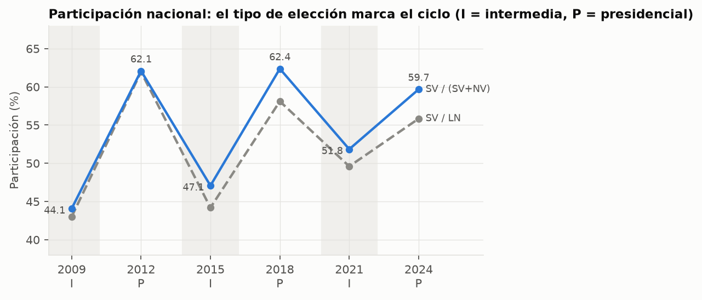

- La participación alterna entre **44–52% en las intermedias y 60–62% en las presidenciales**.
- Las intermedias suben cada vez: 44.1% (2009), 47.1% (2015) y 51.8% (2021).
- Las presidenciales bajan ligeramente en 2024 (59.7%).
- La tasa cruda (SV / LN) se separa de la ajustada en los años con mucho NS: hasta 4.3 pp en 2018.

### 3.2 Distribución entre secciones

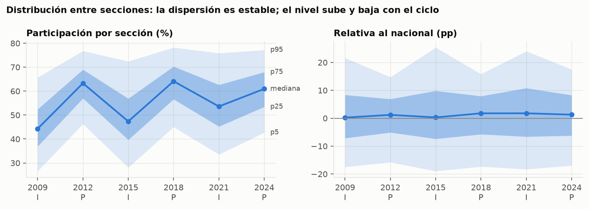

- La mitad central de las secciones abarca de 12 a 17 pp, más en las intermedias: el rango intercuartil es de 15.5, 17.2 y 17.4 pp en 2009, 2015 y 2021, frente a 12.0–14.5 en las presidenciales.
- Expresada **relativa al nacional**, la distribución es estable y está centrada cerca de cero. Esto respalda la decisión de la fase 1 de trabajar con participación relativa.

### 3.3 Edad y sexo

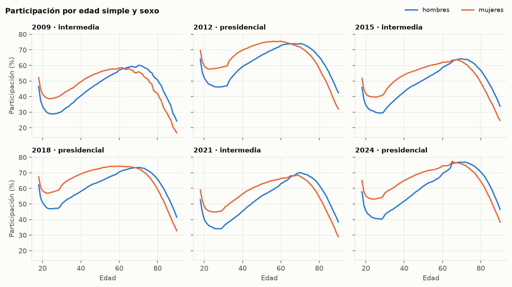

- **Forma de U invertida, en todas las elecciones:**
  - A los 18 años se vota bastante (efecto del primer voto: 61.5% en 2024).
  - Entre los 19 y 20 años se cae unos 10 pp (51.9%).
  - El mínimo está entre los 23 y 26 años (47% en 2024).
  - La participación sube hasta un máximo entre los 62 y 69 años (77% en 2024) y después cae.
- **Las mujeres votan más que los hombres hasta alrededor de los 60–65 años.** La brecha entre 25 y 34 años es de 10 a 13.5 pp y es la mayor en 2024. A edades mayores se invierte.
- **Hallazgo a investigar:** de 2012 a 2024 hay un **salto abrupto de 1.4 a 3 pp** de un año de edad al siguiente, entre los 30 y 33 años: 33 en 2012 y 30–31 en 2015–2024. En 2009 es más tenue (~1 pp, a los 32–35 años). Por lo abrupto, no parece un efecto de comportamiento. Podría ser un efecto administrativo del padrón (por ejemplo, la vigencia de las credenciales). Para la fase 3 implica que los cortes de las bandas de edad no deben caer justo en ese punto, o que hay que verificarlo.

### 3.4 Tipo de sección

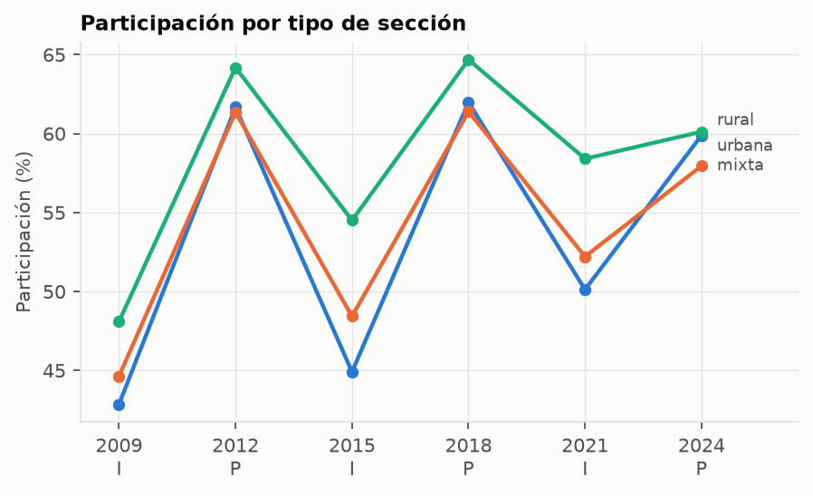

- Las secciones rurales votan más que las urbanas, sobre todo en las **intermedias** (+5.2, +9.6 y +8.3 pp en 2009, 2015 y 2021).
- En las presidenciales la diferencia es menor (+2.5, +2.7 y +0.2 pp en 2012, 2018 y 2024). Es decir, el vaivén por tipo de elección es más pronunciado en lo urbano.
- En 2024, 69% de la lista nominal es urbana, 13% mixta y 18% rural.

### 3.5 Estructura de las trayectorias

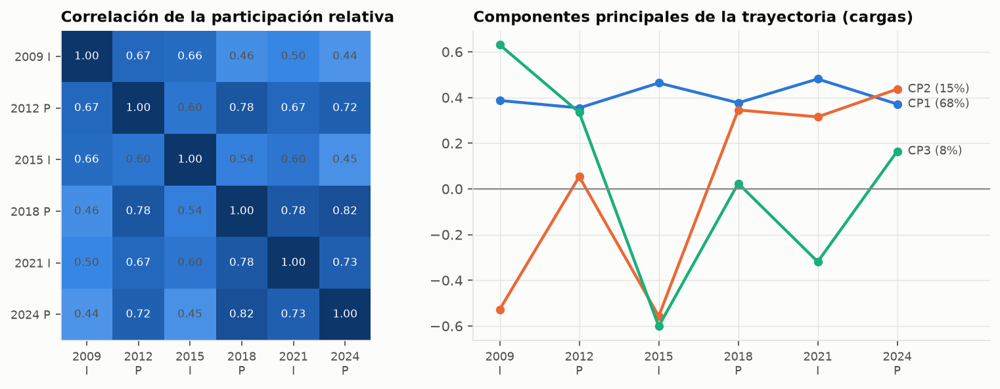

Se analizaron las 54,892 secciones con participación definida en las seis elecciones, con la participación relativa al nacional en puntos porcentuales.

- **Correlaciones:** las presidenciales se parecen mucho entre sí (r = 0.72–0.82). Las intermedias se parecen menos (0.50–0.66), y 2009 y 2015 son las elecciones que menos se parecen a las demás.
- **Componentes principales:**
  - **CP1 (68%)** carga casi igual en las seis elecciones, así que es el **nivel**.
  - **CP2 (15%)** contrasta 2009 y 2015 con 2018–2024, así que es **cambio de nivel entre periodos** (mejora o deterioro).
  - **CP3 (8%)** contrasta 2009 con 2015 y 2021, lo que indica **choques propios de cada intermedia**.
- **Nivel y forma:** el nivel medio explica el **67%** de la varianza total; la forma (desviaciones respecto del propio nivel), el 33%.

**Implicación (riesgo R2 de la fase 1):** un K-means sobre las seis participaciones relativas agruparía sobre todo por nivel (alto, medio, bajo). Para encontrar tipos de trayectoria hay que tratar nivel y forma por separado: variables de forma estandarizadas, o agrupar la trayectoria centrada y usar el nivel como eje aparte. Esta es la decisión principal de la fase 3.

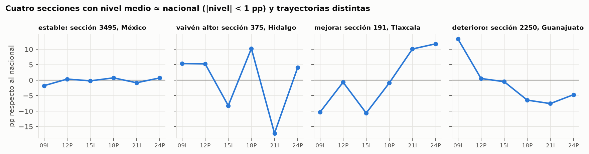

La figura muestra el problema de negocio de la fase 1 con datos reales. Son cuatro secciones con **el mismo nivel medio** (a menos de 1 pp del nacional), elegidas en el percentil 97 de cada rasgo para evitar casos anómalos: una estable, una con vaivén fuerte, una que mejora y una que se deteriora.

### 3.6 Geografía

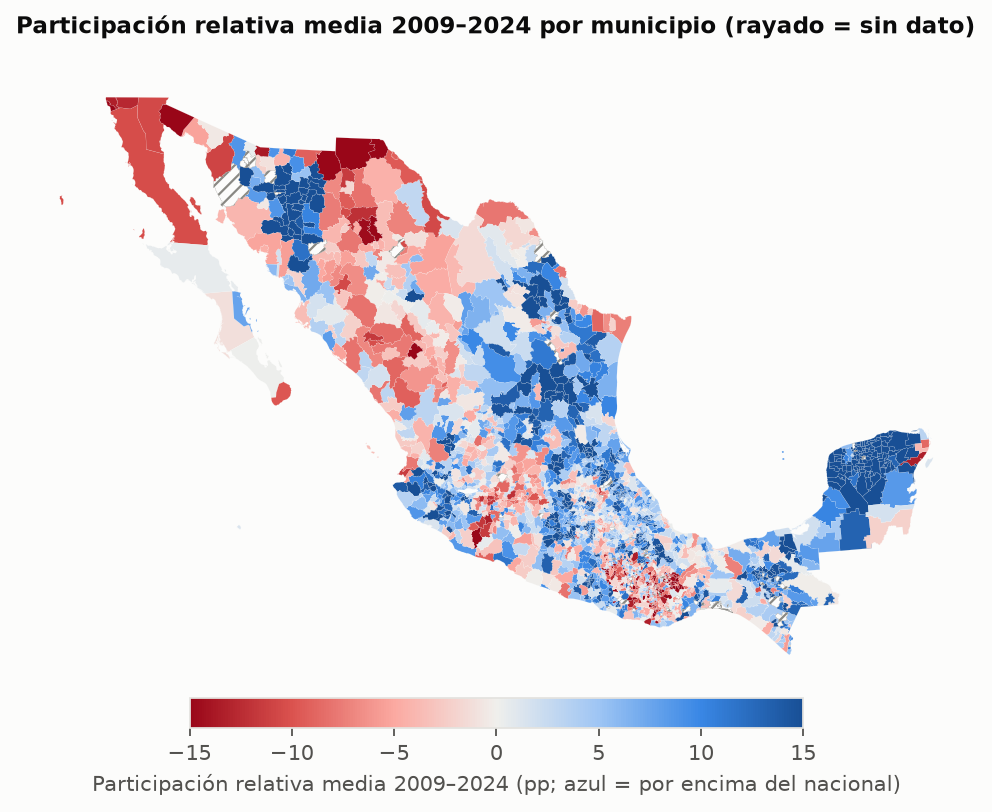

| Variable | R² entidad | R² municipio |
|---|---|---|
| Nivel (media de las seis elecciones) | 0.26 | 0.64 |
| **Vaivén** (presidenciales − intermedias) | **0.51** | **0.81** |
| Participación relativa por elección | 0.22–0.39 | 0.59–0.73 |

- **El nivel tiene un patrón regional claro** (ver mapa): participación baja en Baja California, Sonora, el norte de Chihuahua, el norte de Quintana Roo y partes de Guerrero y Oaxaca; alta en Yucatán y Campeche, Nuevo León y buena parte del centro-norte.
- **El vaivén es todavía más jurisdiccional que el nivel.** Es compatible con el efecto de las elecciones locales concurrentes, que cambian según la entidad y el año. Esto no se verificó aquí; es una variable de contexto candidata para el árbol de la fase 4.

### 3.7 Persistencia de los rasgos (prueba preliminar de H2 y H3)

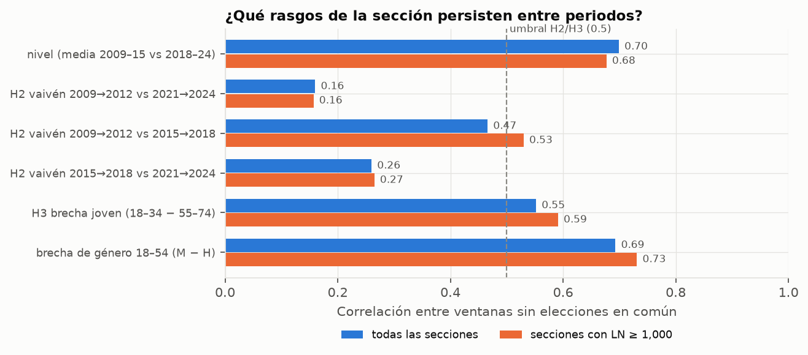

Correlación por sección entre ventanas sin elecciones en común (umbral de la fase 1: 0.5).

| Rasgo | r (todas) | r (LN ≥ 1,000) | Resultado preliminar |
|---|---|---|---|
| Nivel (2009–2015 frente a 2018–2024) | 0.70 | 0.68 | Persistente |
| **H2** vaivén 2009→2012 frente a 2021→2024 | **0.16** | 0.16 | **No persiste** (prueba definida en la fase 1) |
| H2 vaivén 2009→2012 frente a 2015→2018 | 0.47 | 0.53 | Limítrofe |
| H2 vaivén 2015→2018 frente a 2021→2024 | 0.26 | 0.27 | No persiste |
| **H3** brecha de jóvenes (18–34 − 55–74) | **0.55** | 0.59 | **Persistente** |
| Brecha de género 18–54 (M − H) | 0.69 | 0.73 | Persistente |

Se reproduce el hallazgo del hackathon: la intermitencia no es un rasgo estable del territorio. Además, el vaivén se parece más entre elecciones cercanas que entre lejanas, lo que sugiere que depende de condiciones políticas que cambian con el tiempo.

### 3.8 Regresión a la media (antecedente de H5)

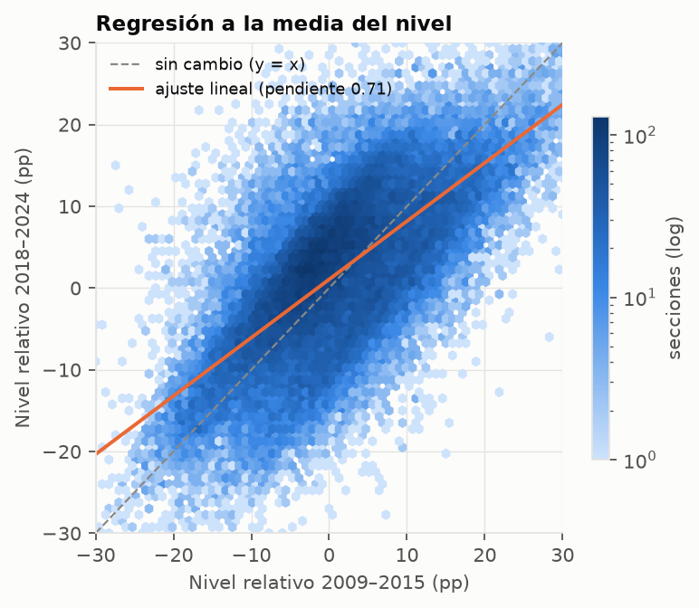

- La pendiente del nivel 2018–2024 sobre el de 2009–2015 es **0.71**: las secciones extremas tienden a acercarse al promedio. Por eso un «deterioro» medido como simple diferencia confundiría el cambio real con este efecto, y la fase 1 hizo bien en definir H5 sobre el residuo.
- Ese residuo tiene una desviación estándar de 7.2 pp.
- 23% de las secciones caen más de 5 pp por debajo de lo esperado.
- El municipio explica el **68%** del residuo y la entidad el 40%: el cambio también es sobre todo jurisdiccional.

---

## 4. Calidad de los datos (2.4)

### 4.1 Validación externa

| Elección | Ámbito | Publicado por el INE | Calculado | Diferencia |
|---|---|---|---|---|
| 2012 | Nacional | 62.1% | 62.08% | −0.02 pp |
| 2018 | Nacional | 62.4% | 62.37% | −0.03 pp |
| 2024 | Nacional | 59.7% | 59.67% | −0.03 pp |
| 2024 | Yucatán | 71.4% | 71.45% | +0.05 pp |
| 2024 | Baja California | 47.0% | 47.05% | +0.05 pp |

Las cinco cifras coinciden dentro del redondeo. Las de 2009, 2015 y 2021 no se encontraron publicadas en texto; para validarlas habría que descargar la tabla «Datos generales» del tablero del INE.

### 4.2 Verificaciones de lectura (192 archivos)

| Verificación | Resultado |
|---|---|
| Columnas iguales en los 192 archivos | Sí |
| Celdas no numéricas o vacías en los conteos | 0 |
| Registros con LN ≠ SV + NV + NS | 0 |
| Valores negativos | 0 |
| Duplicados sección × sexo × edad | 0 |
| Metadatos (municipio, tipo, distrito) que cambian dentro de una sección y elección | 0 |
| Distrito federal vacío | 539 secciones-elección en 2009–2012, todas de secciones que ya no existen en 2021 (los distritos vienen en el marco 2021) |
| Distrito local vacío en 2024 | 136 secciones |

### 4.3 Registros sin captura (NS)

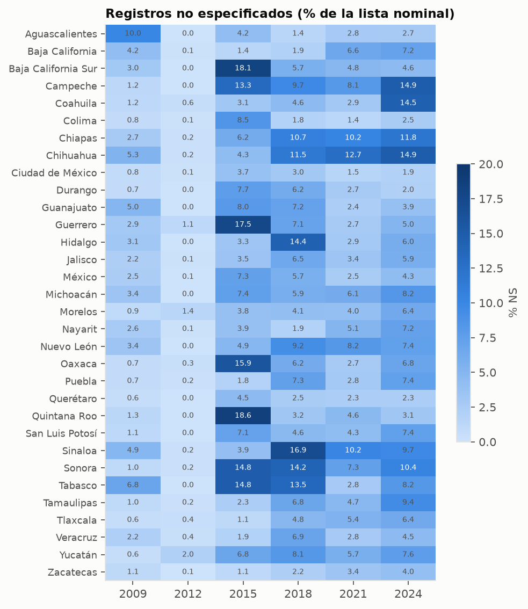

- **Nivel nacional.** El NS va de 0.2% (2012) a 6.8% (2018). Es muy desigual entre entidades: hasta 18.6% (Quintana Roo, 2015) y 16.9% (Sinaloa, 2018).
- **Por sección.** 30,718 secciones-elección tienen más de 20% de NS, y **9,438 tienen 100%**, con la participación indefinida.
- **Prueba del supuesto de la fase 1** («el NS no depende del comportamiento»). Se comparó la participación relativa de cada sección en una elección con el promedio de sus otras elecciones:

| NS de la sección en esa elección | Casos | Desviación media | Desviación estándar |
|---|---|---|---|
| 0% | 363,489 | −0.03 pp | 7.8 pp |
| 0–5% | 2,903 | +0.89 pp | 5.1 pp |
| 5–20% | 2,841 | −0.34 pp | 7.4 pp |
| 20–50% | 16,495 | +0.36 pp | 8.0 pp |
| 50–<100% | 4,100 | +0.57 pp | 11.1 pp |

Las desviaciones son menores de 1 pp, pequeñas frente a la variación normal de 5 a 11 pp, y no crecen con el NS. **El supuesto se sostiene:** el NS no sesga la participación. Sí la vuelve más ruidosa cuando pasa de 50% (desviación estándar de 11.1 pp), porque se calcula con menos registros.

### 4.4 Edades extremas

En cada elección hay entre 10 mil y 33 mil registros con edad mayor de 100 años, hasta 140. En 2024, las personas de 100 años o más suman 19,765 en la lista nominal (0.02%) y su participación es de 18%. Probablemente incluyen registros desactualizados, por ejemplo de personas fallecidas que siguen en la lista nominal. Su peso es despreciable para las tasas de sección, pero conviene excluir del análisis por edad a quienes tienen más de 100 años.

### 4.5 Cobertura temporal y cambios cartográficos

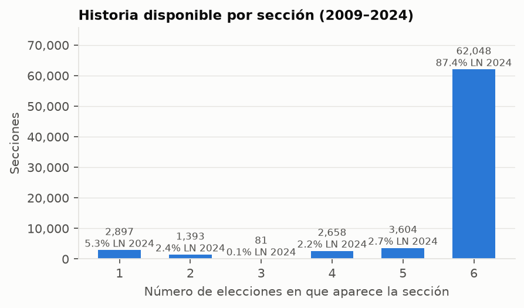

- **Cobertura.** De 72,681 secciones distintas, **62,048 aparecen en las seis elecciones** (87.4% de la lista nominal de 2024) y 68,310 en al menos cuatro (92.3%).
- **Altas.** Por año: 1,810 (2012), 1,936 (2015), 47 (2018), 1,179 (2021) y 2,775 (2024). Las secciones que aparecen por primera vez en 2024 tienen 5.2 M de electores: son el mayor grupo sin historia.
- **Bajas.** Por año: 97 (2009), 221 (2012), 1 (2015), 775 (2018) y 836 (2021).
- **Cambios en la sección:** 1,617 secciones cambian de tipo (sobre todo de rural a mixta, 599, y de mixta a urbana, 439), y 254 cambian de clave de municipio (entre ellas, las de los municipios creados después de 2020; §5).
- **El hueco de 2012.** **1,048 secciones** existen en 2009 y en 2015–2024, pero faltan en 2012. No es un cambio cartográfico:
  - Su tamaño es el mismo antes y después (mediana de 519 electores en 2009 y 500 en 2015).
  - Su participación relativa en 2015 es normal (+1.4 pp, frente a +1.5 pp del resto).
  - Se concentran en Sinaloa (256), Chihuahua (155), Guerrero (87), Michoacán (65) y Tamaulipas (52).

  Además, en 2012 la lista nominal baja incluso en las secciones presentes en las seis elecciones (72.0 M en 2009 → **70.6 M en 2012** → 75.4 M en 2015), y el NS de ese año es casi cero (0.2%). La explicación más consistente es que **en 2012 los cuadernillos no capturados se omitieron en lugar de registrarse como NS**. En la fase 3, la ausencia en 2012 debe tratarse como dato faltante.

### 4.6 Tamaño de sección y ruido

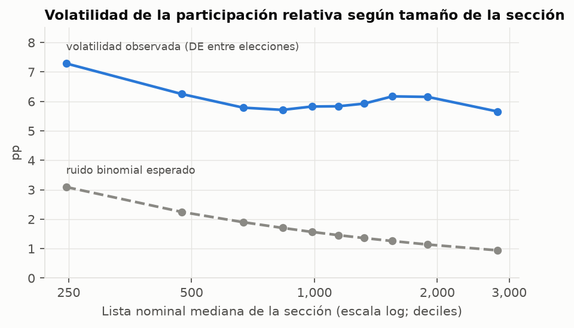

- **Tamaño en 2024.** La lista nominal por sección tiene una mediana de 1,111. El percentil 1 es de 138 y el percentil 99 de 6,332, con un máximo de 25,132. Hay 68 secciones con menos de 100 electores y 2,000 con menos de 200.
- **Volatilidad.** La desviación estándar de la participación relativa entre elecciones es de **7.3 pp en el decil más pequeño** y de 5.7–6.2 pp en los demás.
- **Ruido estadístico.** El esperado por tamaño (binomial) es de 3.1 pp en el decil más pequeño y de ~1 pp en el más grande.

La mayor parte de la volatilidad es **variación real**, no ruido de muestreo. Un umbral bajo (del orden de 200–300 electores) o un encogimiento hacia la media basta para controlar el ruido sin perder muchas secciones.

### 4.7 Cobertura del ECEG y de la cartografía

| Fuente | Universo | Cobertura en secciones | Cobertura en lista nominal |
|---|---|---|---|
| ECEG 2020 | Secciones de 2024 | 96.1% | 94.7% |
| ECEG 2020 | Secciones con las seis elecciones | **100%** | **100%** |
| Cartografía 2021 | Secciones de 2024 | 96.1% | 94.7% |
| Cartografía 2021 | Secciones con las seis elecciones | **100%** | **100%** |

Los nulos del ECEG están todos en secciones con menos de 50 habitantes: son datos protegidos por confidencialidad. Hay 66 secciones con población cero en el censo.

---

## 5. Índice de Rezago Social frente a medición de pobreza (2.5)

Con los criterios fijados en la fase 1 (§4.4), sin usar la relación de ninguna fuente con la participación.

**Cruce de municipios.** Solo el 44.6% de las claves municipales del INE coinciden con las del INEGI, que es la clave del CONEVAL. Se construyó el cruce `cruce_municipios_ine_inegi.csv` por nombre dentro de cada entidad:

| Método | Municipios | Detalle |
|---|---|---|
| Nombre exacto | 2,459 | Usa todas las variantes de nombre como alias; los nombres repetidos se emparejan en orden, como los dos San Juan Mixtepec de Oaxaca |
| Aproximado | 5 | Errores de captura |
| Contenido | 5 | Nombres largos o cortos del mismo municipio |
| Municipio de origen | 8 | Creados después de 2020 (Eldorado, Juan José Ríos, Ñuu Savi, Las Vigas, San Nicolás, Santa Cruz del Rincón, Dzitbalché, San Felipe). El origen se infirió de los propios conteos: el municipio al que pertenecían sus secciones antes |
| Sin cruce | 0 | — |

Ninguna clave INEGI quedó asignada a dos municipios INE.

| Criterio | Índice de Rezago Social | Medición de pobreza |
|---|---|---|
| **C1. Cobertura** (lista nominal 2024 de las secciones con las seis elecciones) | 99.7% (2010), 99.6% (2015), 100% (2020) | 99.7% (2010), 99.6% (2015), 99.96% (2020) |
| **C2. Comparabilidad temporal** | **No comparable**: la nota del IRS 2020 dice que, por su metodología, «no es posible realizar un análisis del comportamiento del índice o del grado de rezago entre los periodos». La versión comparable solo existe como script | **Comparable**: «serie quinquenal comparable 2010-2020» con la misma metodología |
| **C3. Valor añadido sobre el ECEG** (R², validación cruzada por entidad) | **0.98** en el índice y en todos sus indicadores: el ECEG lo reproduce casi por completo | 0.84 pobreza; 0.84 pobreza extrema; **0.77** ingreso inferior a la línea de pobreza; **0.69** vulnerables por ingreso; 0.28 carencia por alimentación |
| **C4. Granularidad** | También por localidad (2000–2020) | Municipal; existe una medición para localidades urbanas en 2020 |
| **C5. Interpretabilidad** | Índice compuesto, difícil de leer en una regla | Porcentajes de personas con carencias concretas; se leen directo en una regla |

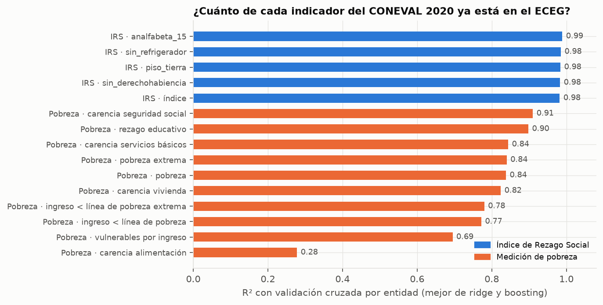

Las dos fuentes están muy relacionadas: r = 0.78 entre el índice y la pobreza en 2020, y 0.88 con la pobreza extrema.

**Decisión: se usa la medición de pobreza.** Las dos cumplen la cobertura (C1 ≥ 98%). La pobreza aporta más información que el ECEG no tiene (C3), sobre todo el **ingreso**, que el censo por sección no mide. También es comparable entre años (C2) y más interpretable (C5). El Índice de Rezago Social se descarta porque es redundante con el ECEG.

**Advertencia:** las cifras municipales de pobreza son estimaciones de modelos para áreas pequeñas, con error propio. Parte de lo que el ECEG «no explica» puede ser ese error, no información nueva. Por eso en la fase 3 conviene usar pocos indicadores de pobreza (ingreso inferior a la línea de pobreza y pobreza extrema), no los 16.

---

## 6. Qué debe decidir la fase 3

1. **Universo de secciones.** Las 62,048 con las seis elecciones, o un criterio de al menos cinco elecciones, que recupera secciones con una elección sin captura o con el hueco de 2012.
2. **Elecciones sin dato.** Hay 7,156 secciones con alguna elección con 100% de NS, más el hueco de 2012. Opciones: imputar con la estructura de la propia sección y del municipio, o calcular las variables de forma con las elecciones disponibles.
3. **Separar nivel y forma** antes de agrupar (§3.5), porque 67% de la varianza es nivel.
4. **Umbral mínimo de lista nominal** de 200–300 electores, o encogimiento hacia la media (§4.6).
5. **Bandas de edad:** excluir a quienes tienen más de 100 años y revisar el salto de los 30–33 años antes de fijar los cortes de la brecha de jóvenes.
6. **Distritos:** no usar DEF ni DEL para comparar 2024 con años anteriores.
7. **Contexto:**
   - ECEG por sección: los 29 indicadores preseleccionados.
   - Medición de pobreza municipal 2020: ingreso inferior a la línea de pobreza y pobreza extrema, unida con el cruce de municipios INE-INEGI.
   - Candidata: concurrencia con elecciones locales, por el peso jurisdiccional del vaivén (§3.6).

## 7. Estado de los riesgos e hipótesis de la fase 1

| Riesgo o hipótesis | Estado tras la fase 2 |
|---|---|
| R1 Continuo, silueta baja | Sin evaluar todavía (es de la fase 4); la estructura por componentes principales (un componente dominante) es compatible con un continuo |
| R2 Grupos solo por nivel | **Confirmado como riesgo**: el nivel es 67% de la varianza |
| R3 Ciclo nacional | Resuelto con la participación relativa (§3.2) |
| R4 / H2 Solo presidenciales | **Falla en la prueba preliminar** (r = 0.16) |
| R5 Secciones pequeñas | Menor de lo previsto (§4.6) |
| R6 Cambios cartográficos | Cuantificado: 87.4% de la lista nominal 2024 tiene las seis elecciones; se descubrió el hueco de 2012 |
| R7 NS variable | Verificado: no sesga, solo agrega ruido |
| R9 Enlaces del INE | Vigentes al 17-nov-2026 |
| H3 Jóvenes ausentes | **Pasa la prueba preliminar** (r = 0.55) |
| H5 En deterioro | Hay regresión a la media fuerte (pendiente 0.71); el residuo es sobre todo municipal |

No hubo motivo para ajustar los umbrales T1–T7 de la fase 1.

## 8. Reproducibilidad

Desde la raíz del repositorio, con `uv` instalado (las dependencias van declaradas en cada script):

```
uv run src/fase2/01_descargar.py          # descarga 0.46 GB (idempotente)
uv run src/fase2/02_construir_bases.py    # ~5 min: bases de los conteos, ECEG y cartografía
uv run src/fase2/03_describir_calidad.py  # ~1 min: descripción y calidad (§2, §4)
uv run src/fase2/04_explorar.py           # ~2 min: exploración (§3)
uv run src/fase2/05_comparar_coneval.py   # ~6 min: comparación del CONEVAL (§5)
```
Tiempos medidos en una laptop con Apple Silicon. `data/` no se versiona; `resultados/` sí.

## Referencias

- Chapman, P. et al. (2000). *CRISP-DM 1.0: Step-by-step data mining guide*. SPSS.
- CONEVAL (2021). *Índice de Rezago Social 2020. Nota de principales resultados*; *Índice de Rezago Social Longitudinal 2000-2020. Nota técnica*; *Metodología para la medición de la pobreza en los municipios de México, 2020*.
- INE (2025). *Manual de la plataforma de Conteos Censales de Participación Ciudadana 2009-2024*. DECEyEC.
- INE (2024). *Conteos Censales de Participación Ciudadana 2009–2024* [datos abiertos].
- INE-INEGI (2020). *Estadísticas Censales a Escalas Geoelectorales 2020*.
