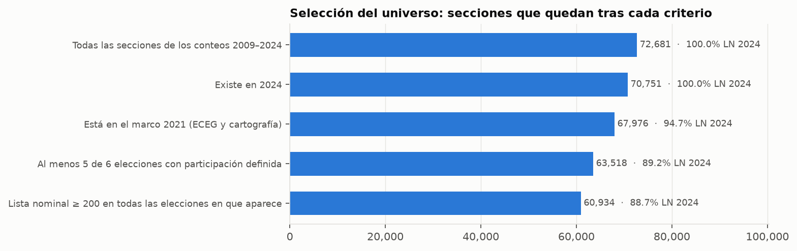
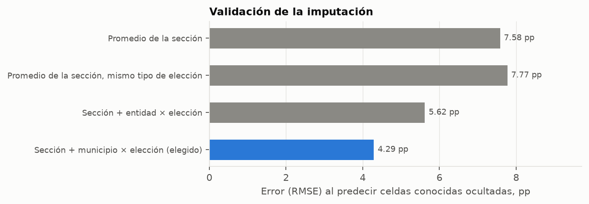
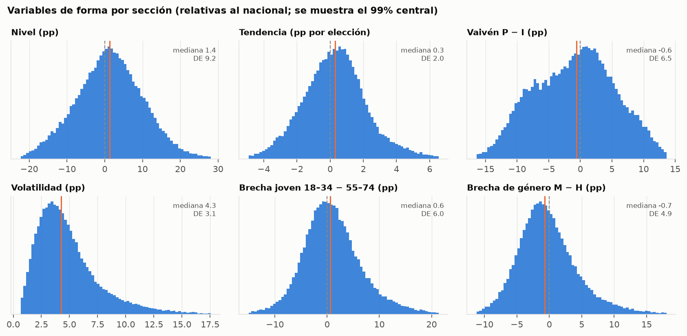
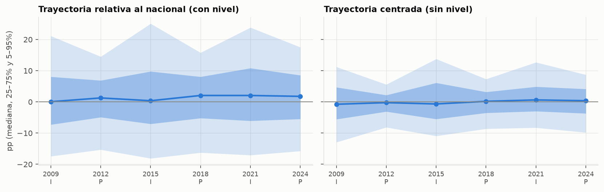
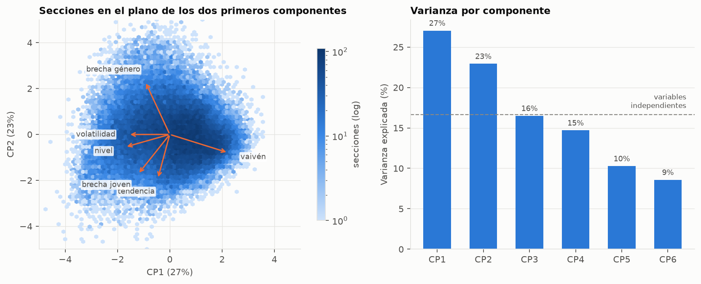

# Fase 3 de CRISP-DM: preparación de los datos

**Proyecto:** Trayectorias de participación electoral en México: segmentación de secciones electorales 2009–2024
**Versión:** borrador 2 (19 de noviembre de 2026). El equipo confirmó el universo de 5 de 6 elecciones y ajustó el criterio T3 (§7); las decisiones marcadas con ⚑ siguen abiertas.

Este documento cubre las cinco tareas de la fase 3 de CRISP-DM 1.0 (Chapman et al., 2000):
- 3.1 selección de los datos (§1);
- 3.2 limpieza (§2);
- 3.3 construcción de variables (§3);
- 3.4 integración (§4);
- 3.5 formato (§5).

La §6 explica cómo quedaron preparados los datos para el enfoque que acordó el equipo para la fase 4: cada integrante prueba un modelo distinto y al final se combinan en un ensamble. En §7 están las decisiones abiertas, en §8 el estado de los riesgos y en §9 cómo reproducir todo.

Cada decisión se apoya en la evidencia de la fase 2 ([`docs/fase2_comprension_datos.md`](fase2_comprension_datos.md), §6) o en una prueba hecha aquí. Las cifras salen de los scripts de `src/fase3/`; las tablas están en `resultados/fase3/tablas/` y las figuras en `resultados/fase3/fig/`.

En esta fase **no se agrupa ni se relaciona el contexto con la participación**. Eso es de la fase 4.

---

## Resumen

| # | Resultado | Consecuencia para la fase 4 |
|---|---|---|
| 1 | **Universo: 60,934 secciones, 88.7% de la lista nominal de 2024.** Exigir las seis elecciones sin imputar habría dejado 53,050 (81.0%) | Se agrupa sobre 60,934 secciones; 53,050 sirven para la prueba de robustez sin imputación |
| 2 | **7,884 secciones (12.9%) tienen una elección imputada** con un modelo sección + municipio × elección. Su error al predecir valores conocidos es de **4.3 pp**, frente a 7.6 pp del promedio de la sección | Cada celda imputada queda marcada (`imputado_AAAA`) |
| 3 | **Seis variables de forma:** nivel, vaivén, tendencia, volatilidad, brecha joven y brecha de género. Tendencia y vaivén se estiman juntos para no confundirlos. La correlación entre variables no pasa de 0.29 en valor absoluto | Matriz estandarizada con el nivel como columna separable (riesgo R2) |
| 4 | **El tamaño de la sección casi no explica las variables** (R² ≤ 0.034 por deciles de lista nominal) | Riesgo bajo de que los grupos sean un artefacto del tamaño (T5) |
| 5 | **La varianza está repartida**: en el PCA el primer componente explica 27%, y el sexto todavía 9% | No hay pocas direcciones dominantes: es probable un continuo (riesgo R1). La prueba contra el nulo (T1) será decisiva |
| 6 | **Se corrigió el denominador de los indicadores de vivienda del ECEG**: con el de la fase 2, 15,646 secciones daban proporciones mayores que 1 | El contexto por sección queda en [0, 1]. La decisión de la fase 2 sobre el CONEVAL no cambia al corregirlo (§4.1, §7) |
| 7 | Contexto completo para las 60,934 secciones: 29 indicadores del ECEG, 2 de pobreza municipal y 3 de los conteos. 45 secciones usan algún valor de su municipio o entidad | Entrada del árbol CART (M3) |
| 8 | Las mismas variables se construyeron con la **ventana 2009–2018**, imputada sin información de 2021 ni 2024 | Entrada de la prueba de validez temporal (T3) |
| 9 | **Contrato común para el ensamble:** mismas entradas, misma muestra de evaluación, mismas réplicas bootstrap, misma evaluación T1–T5 y un formato único de entrega (`src/modelado.py`, `src/fase4/plantilla_modelo.py`) | Cada integrante solo escribe la función de su modelo; el ensamble lee todas las entregas sin volver a correr nada (§6) |

---

## 1. Selección de los datos (3.1)

### 1.1 Universo de secciones

`src/fase3/01_seleccionar_limpiar.py` aplica cinco criterios en cascada:



| Criterio | Secciones | Excluidas | % de la lista nominal 2024 | Por qué |
|---|---|---|---|---|
| Todas las secciones de los conteos 2009–2024 | 72,681 | — | 100.0 | — |
| Existe en 2024 | 70,751 | 1,930 | 100.0 | La tipología sirve para planear las elecciones que vienen; una sección que ya no existe no se puede atender |
| Está en el marco 2021 (ECEG y cartografía) | 67,976 | 2,775 | 94.7 | Sin contexto ni polígono no hay árbol ni mapa. Las 2,775 son exactamente las secciones que aparecen por primera vez en 2024 (fase 2 §4.5); todas tienen una sola elección |
| Al menos 5 de 6 elecciones con participación definida | 63,518 | 4,458 | 89.2 | Con una elección faltante la trayectoria se recupera bien (§2); con dos ya no |
| Lista nominal ≥ 200 en todas las elecciones en que aparece | **60,934** | 2,584 | **88.7** | Control del ruido de las secciones pequeñas (fase 2 §4.6) |

**¿Por qué 5 de 6 y no 6 de 6?** Exigir las seis elecciones válidas deja 53,050 secciones (81.0% de la lista nominal 2024). Aceptar una faltante recupera 7,884 secciones y 7.7 pp de lista nominal, con un costo de imputación medido en §2.2. Las secciones con faltante no son una muestra al azar. Se concentran donde hubo mucho NS y en el hueco de 2012 (fase 2 §4.3 y §4.5): son el 35% de las secciones de Sinaloa, el 27% de Chihuahua y el 26% de Quintana Roo, frente a 13% en el país. Dejarlas fuera sesgaría el universo geográficamente.

**¿Por qué una lista nominal mínima de 200?** Si se capturan los 200 registros, el ruido binomial de la participación es de 3.5 pp como máximo, menor que la volatilidad típica (4.3 pp de mediana, §3). El umbral excluye 2,584 secciones, pero solo 0.55 pp de la lista nominal. Se aplica en todas las elecciones en que aparece la sección porque el ruido afecta a cada punto de la trayectoria, no solo al último. No se usó encogimiento hacia la media porque el umbral ya basta y es más fácil de explicar.

### 1.2 Atributos

- **Participación:** ajustada, SV / (SV + NV), relativa a la nacional de cada elección (fase 1 §2.4; fase 2 §3.2).
- **No se usan los distritos (DEF, DEL) para comparar**, porque el marco cambia en 2024 (fase 2 §2.1). El distrito de 2024 se conserva solo para ubicar.
- **Sexo no binario (2024, 105 registros):** cuenta en la participación total, pero no en las brechas, que comparan mujeres con hombres.
- **Mayores de 100 años:** no entran en ninguna brecha, porque la de jóvenes compara con 55–74 años (fase 2 §4.4).

## 2. Limpieza de los datos (3.2)

### 2.1 Celdas faltantes

Una celda sección × elección falta si la sección no aparece ese año o si su NS es 100% (la participación no está definida). Las celdas con NS alto pero menor que 100% **se conservan**, porque la fase 2 mostró que el NS no sesga la participación (§4.3). Tratar las de NS ≥ 50% como faltantes habría costado unas 1,500 secciones más.

| Causa | 2009 | 2012 | 2015 | 2018 | 2021 | 2024 |
|---|---|---|---|---|---|---|
| NS 100% | 703 | 37 | 1,300 | 1,516 | 943 | 1,273 |
| No aparece | 1,478 | 634 | 0 | 0 | 0 | 0 |
| **Total** | **2,181** | **671** | **1,300** | **1,516** | **943** | **1,273** |

- **Las 634 ausencias de 2012** son el hueco de 2012 de la fase 2: se tratan como dato faltante, no como cambio cartográfico.
- **Las 1,478 ausencias de 2009** son secciones que aparecen desde 2012: para estar en el universo, una sección ausente en 2009 debe tener válidas las otras cinco elecciones. Su valor imputado de 2009 es contrafactual: estima cómo habría votado ese territorio con su nivel actual y el comportamiento de su municipio. Quedan marcadas para excluirlas en las pruebas de robustez.

### 2.2 Imputación

**Modelo.** La participación relativa de la sección *s* en la elección *e* se modela como un efecto de la sección más un efecto de su municipio en esa elección:

> r[s, e] = a[s] + b[municipio(s), e] + error

Se ajusta por mínimos cuadrados alternados con las celdas disponibles. El valor imputado es a[s] + b[m, e]. Si el municipio tiene menos de 5 secciones válidas en esa elección, se usa el efecto de la entidad. Se eligió el efecto municipio × elección porque el municipio explica el 81% de la varianza del vaivén (fase 2 §3.6): si una elección fue atípica en un municipio, sus secciones faltantes lo reflejan.

**Validación.** Se ocultó una celda al azar en 20% de las secciones completas (10,610 celdas) y se predijo con cada método:



| Método | RMSE (pp) | MAE (pp) | Sesgo (pp) |
|---|---|---|---|
| Promedio de la sección | 7.58 | 5.85 | 0.00 |
| Promedio de la sección, mismo tipo de elección | 7.77 | 5.61 | −0.05 |
| Sección + entidad × elección | 5.62 | 4.14 | 0.01 |
| **Sección + municipio × elección (elegido)** | **4.29** | **3.02** | **0.07** |

Por elección, el error va de 3.3 pp (2018) a 5.3 pp (2009). Las presidenciales (3.3–4.0 pp) se imputan mejor que las intermedias (4.5–5.3 pp), lo que coincide con la menor dispersión de las presidenciales en la fase 2 (§3.2).

**Limitación.** La celda imputada hereda el comportamiento de su municipio en esa elección, así que la forma de esas 7,884 secciones se acerca a la de su municipio. Por eso la fase 5 debe repetir el agrupamiento solo con las 53,050 secciones sin imputar y comparar.

**Ventana 2009–2018.** Para la prueba de validez temporal (T3), la trayectoria 2009–2018 se imputa por separado, con solo esas cuatro elecciones. Así los grupos formados con 2009–2018 no contienen información de 2021 ni de 2024. Las 60,934 secciones tienen al menos 3 de 4 elecciones válidas en la ventana.

## 3. Construcción de variables (3.3)

### 3.1 Variables de forma

`src/fase3/02_construir_variables.py` ajusta para cada sección una regresión con sus seis valores de participación relativa:

> r[e] = nivel + tendencia · (t[e] − 2.5) + vaivén · (P[e] − 0.5) + residuo,  con t = 0, …, 5 y P = 1 en las presidenciales

| Variable | Definición | Unidad | Para qué sirve |
|---|---|---|---|
| **nivel** | Promedio de las seis elecciones | pp sobre el nacional | H1 constantes, H4 abstención crónica |
| **tendencia** | Cambio por elección (cada 3 años), descontado el vaivén | pp por elección | H5 en deterioro |
| **vaivén** | Presidenciales − intermedias, descontada la tendencia, relativo al vaivén nacional | pp | H2 solo presidenciales |
| **volatilidad** | Desviación estándar del residuo (3 grados de libertad) | pp | H1 constantes (baja volatilidad) |
| **cambio_ajustado** | Nivel 2018–2024 menos el esperado por la regresión a la media desde 2009–2015 (pendiente 0.715) | pp | H5, tal como la definió la fase 1 |

**¿Por qué estimar tendencia y vaivén juntos?** La secuencia empieza con una intermedia (2009) y termina con una presidencial (2024), así que el tiempo y el tipo de elección están correlacionados (r = 0.29). Por eso una diferencia simple entre presidenciales e intermedias absorbe parte de la tendencia; con este diseño es exactamente igual al vaivén más la tendencia. La regresión separa las dos cosas.

**`cambio_ajustado` no entra en la matriz de agrupamiento.** Su correlación con la tendencia es de 0.87, así que repetiría la misma información. Se conserva para evaluar H5 en la fase 5.

### 3.2 Brechas por edad y sexo

Se calculan por elección, relativas a la brecha nacional de esa elección, y se promedian en las elecciones **observadas**; las imputadas no tienen datos por edad.

| Variable | Definición | Brecha nacional (2009 → 2024) | Persistencia entre periodos (r) |
|---|---|---|---|
| **brecha_joven** | Participación 18–34 − participación 55–74 | −20.5 → −22.9 pp | 0.54 (fase 2: 0.55) |
| **brecha_genero** | Participación de mujeres − hombres, 18–54 años | +9.1 → +12.3 pp | 0.70 (fase 2: 0.69) |

Un valor positivo de `brecha_joven` indica que en esa sección los jóvenes se rezagan **menos** que en el país. Un valor negativo indica que se rezagan más, que es lo que H3 llama «jóvenes ausentes».

**Bandas de edad.** La fase 2 encontró un salto abrupto de participación entre los 30 y 33 años (§3.3). De 2012 a 2024 ese salto queda dentro de la banda 25–34, así que no cae en la frontera entre jóvenes (18–34) y adultos. La excepción es 2009: el salto mayor de los hombres (1.3 pp) está justo entre los 34 y 35 años, en el corte. Es una sola elección de seis y un salto pequeño, así que no se cambiaron los cortes, pero queda anotado. Las bandas tampoco incluyen a los mayores de 74 años, entre ellos los registros de más de 100.

Una sección no tenía registros de algún grupo; su brecha se tomó de la mediana de su municipio y quedó marcada (`brecha_imputada`).

### 3.3 Descripción



| Variable | Mediana | DE | P5 | P95 | Asimetría |
|---|---|---|---|---|---|
| nivel (pp) | 1.35 | 9.23 | −13.98 | 16.40 | 0.07 |
| tendencia (pp/elección) | 0.30 | 2.03 | −2.93 | 3.80 | 0.28 |
| vaivén (pp) | −0.58 | 6.49 | −11.41 | 9.63 | −0.06 |
| volatilidad (pp) | 4.27 | 3.06 | 1.49 | 10.95 | **1.81** |
| brecha_joven (pp) | 0.60 | 6.02 | −7.69 | 11.77 | 0.52 |
| brecha_genero (pp) | −0.68 | 4.92 | −6.99 | 8.82 | 0.90 |

La mediana del nivel es positiva (+1.35 pp) porque cada sección pesa igual. Las secciones pequeñas y rurales votan más que las grandes y urbanas (fase 2 §3.4); ponderado por lista nominal, el nivel promedio es de +0.38 pp.

**Correlaciones** (completas en `variables_correlacion.csv`). La mayor en valor absoluto entre las seis variables de agrupamiento es la de nivel con vaivén: −0.28, y −0.29 ya estandarizadas. Las secciones que votan más tienden a tener menos vaivén. Fuera de esa, ninguna pasa de 0.28, así que cada variable aporta información propia.

**Relación con el tamaño de la sección** (anticipa T5):

| Variable | r con log(lista nominal 2024) | R² por deciles de lista nominal |
|---|---|---|
| nivel | −0.09 | 0.011 |
| tendencia | −0.11 | 0.015 |
| vaivén | 0.17 | 0.034 |
| volatilidad | −0.07 | 0.010 |
| brecha_joven | −0.02 | 0.001 |
| brecha_genero | 0.01 | 0.008 |

El tamaño explica como máximo el 3.4% de la varianza de una variable. El umbral de T5 (η² < 0.10 entre grupos) tiene margen, a menos que el agrupamiento amplifique el poco efecto que hay.

### 3.4 Variables de la ventana 2009–2018

Se calculan igual con cuatro elecciones (sufijo `_v`). La volatilidad de la ventana tiene un solo grado de libertad, así que es muy ruidosa. La correlación de cada variable con su versión de la serie completa es de 0.97 en el nivel, 0.86 en el vaivén, 0.70 en la volatilidad y **0.62 en la tendencia**. La tendencia es la variable menos estable: con cuatro puntos se estima mal, y eso hay que tenerlo presente al leer T3.

## 4. Integración de los datos (3.4)

`src/fase3/03_integrar_contexto.py` une a cada sección tres fuentes de contexto.

### 4.1 ECEG 2020 por sección y corrección de denominadores

Se usan los 29 indicadores que preseleccionó la fase 2 (§2.2), calculados por sección en lugar de por municipio.

**Corrección.** Según el diccionario oficial del ECEG, los indicadores de vivienda (`VPH_*`: piso de tierra, drenaje, agua, electricidad, refrigerador, lavadora, internet, computadora, celular, automóvil, un dormitorio) se captan sobre las *viviendas particulares habitadas con características*, **incluidas las que no tienen información de ocupantes** (`VIVPARH_CV`). La fase 2 los dividió entre `VIVPAR_HAB`, que **excluye** esas viviendas.

- Con ese denominador, **15,646 de las 60,934 secciones** tenían al menos una proporción mayor que 1; por ejemplo, un valor de 6.8 en «viviendas con refrigerador».
- Ocurría lo mismo con «ocupantes por vivienda», cuyo numerador incluye la estimación de ocupantes de esas viviendas y su denominador no; llegaba a 97.7.
- Aquí se usan `VIVPARH_CV` para los indicadores de vivienda y `TVIVPARHAB` para los ocupantes. Con eso no queda ninguna proporción fuera de [0, 1] y los ocupantes por vivienda tienen un máximo de 8.4.

La comparación del CONEVAL de la fase 2 (§5, criterio C3) usó las mismas fórmulas agregadas por municipio. Ver §7.

**Faltantes.** 28 secciones tienen algún indicador sin dato (769 celdas). Las 28 tienen menos de 50 habitantes en el censo, que es el caso en que el ECEG protege los datos (fase 2 §4.7). Se rellenan con el valor de su municipio y se marcan con `contexto_imputado`. En total, el universo tiene 57 secciones con menos de 50 habitantes en el censo, a pesar de tener al menos 200 electores en la lista nominal; no se investigó la causa de esa diferencia.

### 4.2 Pobreza municipal 2020 (CONEVAL)

Como recomendó la fase 2 (§5), solo se toman dos indicadores para no cargar el árbol con estimaciones de áreas pequeñas: **% de población con ingreso inferior a la línea de pobreza** y **% en pobreza extrema**. Se unen con el cruce `cruce_municipios_ine_inegi.csv` a partir del municipio INE de 2024. 17 secciones (0.04% de la lista nominal) caen en municipios sin dato de pobreza en 2020; se rellenan con la mediana de su entidad y también se marcan con `contexto_imputado`. En total, esa marca la tienen 45 secciones: 28 por el ECEG y 17 por la pobreza.

### 4.3 Variables de los conteos e identificadores

- **Tipo de sección en 2024:** 39,804 urbanas, 5,761 mixtas y 15,369 rurales.
- **log de la lista nominal 2024.**
- **Crecimiento anual de la lista nominal** desde la primera elección en que aparece la sección. La propuesta pone como ejemplo de regla «secciones urbanas con lista nominal en crecimiento».
- **Identificadores:** entidad, municipio INE 2024, municipio INEGI y distrito federal 2024.

**No se incluyen:**
- **Coordenadas:** el árbol memorizaría la geografía en lugar de explicarla, y T6 valida agrupando por entidad justamente para evitarlo.
- **Concurrencia con elecciones locales:** la fase 2 la propuso como candidata (§3.6), pero no está en ninguna de las fuentes descargadas. ⚑ Ver §7.

## 5. Formato de los datos (3.5)

`src/fase3/04_formatear.py` deja los datos listos para los algoritmos de la fase 4.

### 5.1 Estandarización

Las seis variables de agrupamiento son nivel, vaivén, tendencia, log(volatilidad), brecha_joven y brecha_genero. A cada una:
1. **La volatilidad se pasa a logaritmo** por su asimetría, que baja de 1.81 a −0.26.
2. **Se recorta (winsoriza) al percentil 0.5–99.5.** Se recortan 610 secciones por variable, el 1%. Así unas pocas secciones extremas no mueven los centroides.
3. **Se estandariza** a media 0 y desviación estándar 1.

Los cortes, las medias y las desviaciones usadas están en `estandarizacion.csv`. La matriz de la ventana 2009–2018 se estandariza con sus propias medias y desviaciones.

**Nivel y forma por separado (riesgo R2).** La fase 2 mostró que el nivel es el 67% de la varianza de la trayectoria. Por eso la matriz trae `z_nivel` como una columna más: se puede agrupar con ella (entrada `forma`, seis variables) o sin ella (`forma_sin_nivel`, cinco variables, con el nivel como eje descriptivo aparte).

**Trayectoria centrada para DTW.** Es la trayectoria relativa menos su nivel. Su desviación estándar por elección baja de 11.1 a 6.2 pp; lo que queda es la forma. También se dejó la de la ventana 2009–2018 (`rvc_AAAA`), centrada con su propio nivel.



### 5.2 Componentes principales (solo para visualizar)



| | CP1 (27%) | CP2 (23%) | CP3 (16%) |
|---|---|---|---|
| Carga principal | **vaivén** (+0.62) frente a nivel (−0.47) y volatilidad (−0.44) | **brecha de género** (+0.64) frente a tendencia (−0.54) y brecha joven (−0.48) | volatilidad (+0.68) y tendencia (+0.49) |

- **No hay pocas direcciones dominantes.** Los dos primeros componentes suman solo el 50%. Con seis variables independientes, cada componente explicaría alrededor del 17%. La nube del plano CP1–CP2 tiene una sola masa, sin grupos a la vista.
- **Lectura del primer componente:** las secciones con vaivén alto tienden a tener nivel bajo y volatilidad baja. Es decir, votan por debajo del nacional, sobre todo en las intermedias, y lo hacen de forma regular.

Esto **no** descarta grupos útiles, pero refuerza el riesgo R1: probablemente los datos son un continuo. La prueba contra el nulo (T1) y la estabilidad (T2) de la fase 1 serán las que decidan si los grupos son estructura o solo una partición conveniente.

### 5.3 Archivos

En `data/processed/fase3/` (no se versionan; se regeneran en menos de 10 segundos):

| Archivo | Filas × columnas | Contenido |
|---|---|---|
| `tabla_analitica.parquet` | 60,934 × 84 | Todo: trayectorias, marcas de imputación, variables, contexto e identificadores. Sin celdas vacías |
| `matriz_forma.parquet` | 60,934 × 6 + peso | Variables z de la serie completa |
| `matriz_forma_2009_2018.parquet` | 60,934 × 6 + peso | Variables z de la ventana 2009–2018 |
| `trayectoria_centrada.parquet` | 60,934 × 6 + peso | r − nivel por elección (pp) |
| `trayectoria_centrada_2009_2018.parquet` | 60,934 × 4 + peso | Ídem con la ventana 2009–2018 |
| `modelado_muestra.parquet`, `modelado_bootstrap.parquet` | — | Muestra de evaluación y réplicas bootstrap fijas (§6) |

Archivos intermedios: `trayectorias.parquet`, `variables.parquet` y `contexto.parquet`. El diccionario de las 84 columnas de la tabla analítica está en `resultados/fase3/tablas/diccionario_tabla_analitica.csv`. En todos los archivos las secciones van en el mismo orden.

## 6. Preparación para el modelado en paralelo y el ensamble

### 6.1 El enfoque acordado

El 17 de noviembre de 2026 el equipo acordó que, para la fase 4, **cada integrante experimente con un modelo de agrupamiento distinto y al final se combinen en un ensamble**, que integrará Leonardo. Las razones fueron dos: el modelado es la parte más pesada y más importante, y así todos conocerán qué se hizo y por qué al momento de exponer. Antes de empezar, el equipo se reunirá con los hallazgos de las fases 2 y 3 para decidir qué modelo prueba cada quien.

### 6.2 Por qué hace falta un contrato común

Probar modelos por separado y combinarlos después solo funciona si se prepara antes. Hay cuatro problemas:

1. **Las etiquetas de un agrupamiento son arbitrarias.** El «grupo 2» de K-means no tiene relación con el «grupo 2» de Ward, así que no se pueden promediar ni votar directamente. Un ensamble de agrupamientos se construye con *consenso* (Strehl y Ghosh, 2002): se mide qué tan seguido dos secciones quedan juntas en los distintos modelos. Para eso, todas las particiones deben cubrir **las mismas secciones, en el mismo orden**.
2. **Elegir «los mejores métodos» requiere la misma vara.** Si cada quien calcula su silueta sobre una muestra distinta o define la estabilidad a su manera, los números no se pueden comparar. Los criterios T1–T5 de la fase 1 deben calcularse igual para todos: misma muestra, mismas réplicas bootstrap y mismos datos nulos.
3. **El ensamble también se evalúa.** Para medir la estabilidad (T2) y la validez temporal (T3) del consenso hacen falta las particiones de cada modelo en las mismas réplicas y en la ventana 2009–2018. Si cada integrante las entrega, quien integre el ensamble no tiene que volver a correr los modelos de los demás.
4. **La escala.** Una matriz de pares para 60,934 secciones tendría unos 1,860 millones de pares distintos, demasiado para una laptop. Silueta, Davies-Bouldin y la matriz de consenso se calculan sobre una muestra fija.

### 6.3 Qué se dejó listo

| Pieza | Dónde | Qué garantiza |
|---|---|---|
| Entradas comunes | `cargar_entrada()` en [`src/modelado.py`](../src/modelado.py): `forma`, `forma_sin_nivel`, `trayectoria_centrada`, cada una con su versión 2009–2018 | Todos parten de los mismos datos, con las secciones en el mismo orden (lo verifica al cargar) |
| Muestra de evaluación | `modelado_muestra.parquet`, generado por `src/fase3/05_preparar_modelado.py` | Un orden aleatorio fijo de las secciones: las primeras 8,000 son la muestra por defecto. Las muestras son anidadas, así que una más chica está contenida en la grande |
| Réplicas bootstrap | `modelado_bootstrap.parquet` (mismo script) | 20 réplicas iguales para todos: se remuestrean los 2,461 municipios con reemplazo y cada uno aporta todas sus secciones. La mediana de municipios distintos por réplica es el 63% |
| Datos nulos (T1) | `nulo()` | Normal multivariante con la media y covarianza de la entrada, con semilla fija por réplica |
| Evaluación común | `evaluar_modelo()` | Para k = 4 a 7: T1 (silueta frente al percentil 95 de 20 nulos), T2 (ARI medio frente a la partición completa en 20 réplicas), T3 (η² de la participación observada de 2021 y 2024 con grupos de la ventana, contra grupos al azar y contra los estados agrupados en k regiones; versión 3 de la fase 1, §7), T4, T5, silueta y Davies-Bouldin en el espacio propio y en el común (`forma`). Aplica la regla de elección de k de la fase 1 |
| Entrega | `guardar_modelo()` → `resultados/fase4/modelos/<nombre>/` | `particiones.csv.gz` (todas las k, réplicas y ventana), `metricas.csv` y `ficha.json` (autor, algoritmo, parámetros, semilla). Pesa menos de 1 MB y se sube al repositorio |
| Lectura para el ensamble | `leer_modelos()`, `concordancia()` | Carga todas las entregas; `concordancia()` da el ARI entre pares de modelos (T7) |
| Plantilla | [`src/fase4/plantilla_modelo.py`](../src/fase4/plantilla_modelo.py) | Cada integrante la copia y solo reescribe `ajustar()`. Con `--prueba` corre 2 réplicas y 2 nulos sin guardar nada |

### 6.4 Reglas del contrato

1. El modelo es una función `ajustar(X, k, semilla)` que devuelve una etiqueta entera por renglón de `X`, en el mismo orden.
2. **Debe asignar grupo a todas las secciones.** Si el algoritmo no escala a 60,934 (por ejemplo, Ward con la matriz completa, como advirtió la fase 1 §4.2), se ajusta con una submuestra y el resto se asigna dentro de `ajustar()`, por ejemplo al centroide más cercano.
3. Se usa la semilla que recibe la función, para que cada réplica sea reproducible.
4. Se evalúan y entregan todas las k de 4 a 7. La k de cada modelo se elige con la regla de la fase 1 (§3.3), pero el ensamble puede usar cualquiera.
5. La búsqueda de hiperparámetros (grid search) es libre dentro de cada modelo; los valores finales quedan en la ficha.
6. Un modelo con otra distancia (por ejemplo, DTW) la pasa en `distancia`. Así la silueta real y la de los nulos (T1) se calculan con la misma métrica.

**Costo.** Por cada k se ajusta el modelo 42 veces: 1 completa, 20 nulos, 20 réplicas y 1 ventana. Con el K-means de ejemplo y 2 réplicas, la prueba completa tardó 40 segundos. Un modelo más lento puede bajar `n_replicas` y `n_nulos` para explorar, pero la entrega final debe usar 20 de cada uno para que sea comparable.

**Prueba del flujo.** La plantilla se corrió con el K-means de ejemplo para verificar entrada, evaluación, guardado, lectura y validación. Esa corrida no es un resultado de modelado y no se guardó en el repositorio.

### 6.5 Opciones para el ensamble

La integración del ensamble queda a cargo de Leonardo; las entregas permiten estas opciones:

- **Matriz de coasociación** (Fred y Jain, 2005). Sobre la muestra fija, para cada par de secciones se calcula la fracción de modelos que las pusieron juntas. Esa matriz se agrupa, por ejemplo con enlace promedio, en k de 4 a 7. Para el resto de las secciones, la coasociación promedio con cada grupo de consenso se puede calcular con tablas de contingencia de cada modelo, sin formar la matriz completa.
- **Selección y peso de los miembros.** «Los mejores métodos» se pueden definir como los que cumplen T2 y T4 con la evaluación común. No conviene ponderarlos por su T3, porque T3 favorece a los modelos que agrupan por nivel (§7, decisión 6).
- **Evaluación del consenso.** T2 se obtiene aplicando el mismo consenso en cada réplica con las particiones `boot_k*_r*` de los miembros. T3 se obtiene con las particiones `ventana_k*`. T4 y T5 se calculan directo. T1 no se traslada directo, porque cada miembro tiene su propio nulo en su propio espacio; se puede comparar la silueta del consenso en el espacio común contra los nulos de `forma`.

**Modelos candidatos.** La propuesta compromete tres: K-means sobre las variables de forma, Ward y K-means con DTW sobre la trayectoria centrada. Si hay un cuarto, una opción es un modelo de mezclas gaussianas: da pertenencias graduales, algo útil si los datos son un continuo (R1). La asignación final la decide el equipo en la reunión.

### 6.6 Otras columnas que usarán las fases 4 y 5

| Necesidad | Columnas de `tabla_analitica` |
|---|---|
| Árbol CART (M3) | Indicadores del ECEG, `pct_pobreza_extrema`, `pct_ingreso_inferior_lp`, `tipo_seccion`, `log_LN_2024` y `crecimiento_LN_anual_pct` |
| T6: validación cruzada por entidad | `entidad` |
| Robustez sin imputación | Filtrar `n_imputadas == 0` (53,050 secciones) |
| H5: deterioro | `cambio_ajustado` |
| Mapa | `sid` con la cartografía de la fase 2 (`secciones_2021.parquet`), `mun_ine` para el mapa municipal |

## 7. Decisiones para revisión del equipo ⚑

1. **Universo con 5 de 6 elecciones** (60,934 secciones) y no 6 de 6 (53,050). ✔ **Decidido por el equipo (19-nov-2026): 5 de 6.** La versión estricta sigue disponible con `n_imputadas == 0` para la prueba de robustez.
2. **Lista nominal mínima de 200.** Subirla a 300 dejaría 58,109 secciones: 2,825 menos y 0.95 pp menos de la lista nominal 2024. Se cambia en `MIN_LN`, al inicio de `01_seleccionar_limpiar.py`.
3. **Brecha de género en la matriz de agrupamiento.** La propuesta solo menciona la brecha juvenil, pero promete describir las secciones «por su comportamiento por edad y sexo». Además, la brecha de género es el rasgo más persistente (r = 0.70). Si el equipo prefiere no usarla, basta con quitar `z_brecha_genero` de la entrada.
4. **Concurrencia con elecciones locales.** Habría que construir a mano la tabla entidad × elección con los calendarios electorales locales. Serviría para explicar el vaivén con el árbol, pero no es indispensable para agrupar.
5. **Corrección del ECEG en la fase 2.** La fase 2 usó `VIVPAR_HAB` como denominador de los indicadores de vivienda (§4.1). Se repitió el criterio C3 con los denominadores corregidos, en una copia aparte y sin modificar la fase 2. **La decisión no cambia**: el R² del Índice de Rezago Social pasa de 0.982 a 0.979, el del ingreso inferior a la línea de pobreza de 0.772 a 0.768, y ningún indicador se mueve más de 0.011. Aun así, conviene corregir las fórmulas de `src/fase2/05_comparar_coneval.py` (líneas 211–214) para que el repositorio sea consistente. Se deja a la autora de la fase 2.
6. **Referencia de T3.** ✔ **Decidido por el equipo (19-nov-2026): los estados agrupados en k regiones sustituyen a las 32 entidades.** Quedó registrado como versión 3 de la fase 1. La evidencia se calculó en el universo de la fase 3 con la participación observada (sin imputar):

   | Referencia | R² 2021 | R² 2024 |
   |---|---|---|
   | Grupos al azar del mismo tamaño | ~0.000 | ~0.000 |
   | 32 entidades (v1) | 0.220 | 0.289 |
   | **32 estados agrupados en k = 4 a 7 regiones por su nivel 2009–2018 (v3)** | 0.065–0.112 | 0.110–0.153 |
   | k = 4 a 7 cuantiles del nivel 2009–2018 (solo referencia) | 0.475–0.518 | 0.427–0.466 |

   **Por qué.**
   - Contra el azar, cualquier partición gana.
   - Contra las 32 entidades, la comparación mezcla la calidad de la tipología con el número de grupos. No es un efecto de los grados de libertad, porque con 60,934 secciones el R² ajustado casi no cambia (0.220 → 0.219). Es que 32 estados traen información geográfica real que se pierde al juntarlos en 4 a 7 grupos.
   - La pregunta útil para el negocio es si la tipología dice más del comportamiento futuro que la geografía con el mismo número de grupos. Si no lo hace, para planear bastaría con agrupar estados.

   Las regiones se forman solo con 2009–2018: se ordenan los estados por el nivel medio de sus secciones en la ventana y se cortan en k grupos de tamaño parecido (`regiones_estados()` en `src/modelado.py`). Las 32 entidades y los cuantiles del nivel se siguen reportando en `metricas.csv` como referencia. El cambio se decidió antes de correr los modelos del equipo, con la regla de la fase 1 (§3.3). Para ser transparentes: el problema se notó en la prueba técnica de la plantilla (§6.4), donde el K-means de ejemplo no superaba a las 32 entidades. Pero la razón del cambio es del método, y las cifras de la tabla no dependen de ningún modelo.

   **Advertencia para leer T3.** Cortar solo el nivel en k grupos predice el futuro mejor que cualquier otra referencia (0.43–0.52), porque la participación relativa futura depende sobre todo del nivel. Por eso T3 favorece a los modelos que agrupan por nivel. Los modelos sin nivel (`forma_sin_nivel`, trayectoria centrada) tendrán un T3 más bajo sin ser peores. **T3 sirve para elegir k dentro de un mismo modelo** (la regla de la fase 1), **no para comparar modelos entre sí.**

Aparte de T3, no hubo motivo para ajustar los umbrales de la fase 1.

## 8. Estado de los riesgos tras la fase 3

| Riesgo | Estado |
|---|---|
| R1 Continuo, silueta baja | **Más probable**: el PCA no muestra direcciones dominantes ni grupos visibles (§5.2) |
| R2 Grupos solo por nivel | Mitigado en el formato: existen la entrada `forma_sin_nivel` y la trayectoria centrada |
| R3 Ciclo nacional | Resuelto: todo es relativo a la participación nacional de cada elección |
| R5 Secciones pequeñas | Controlado: lista nominal ≥ 200, y las variables casi no dependen del tamaño (§3.3) |
| R6 Cambios cartográficos | Resuelto con 5 de 6 elecciones e imputación validada; las altas de 2024 quedan fuera (§1.1) |
| R7 NS variable | Resuelto: se usa la tasa ajustada y el NS de 100% se imputa |
| R8 DTW desfasado | Sin cambio: la trayectoria centrada conserva el orden de las elecciones; la banda de Sakoe-Chiba se fija en el modelo |

## 9. Reproducibilidad

Desde la raíz del repositorio, después de los scripts de la fase 2 (al menos `01_descargar.py`, `02_construir_bases.py` y `05_comparar_coneval.py`, que genera el cruce de municipios):

```
uv run src/fase3/01_seleccionar_limpiar.py    # universo, faltantes e imputación (§1, §2)
uv run src/fase3/02_construir_variables.py    # variables de forma y brechas (§3)
uv run src/fase3/03_integrar_contexto.py      # ECEG, pobreza y conteos (§4)
uv run src/fase3/04_formatear.py              # tabla analítica, matrices, PCA y diccionario (§5)
uv run src/fase3/05_preparar_modelado.py      # muestra y réplicas fijas para la fase 4 (§6)
uv run src/fase4/plantilla_modelo.py --prueba # opcional: verifica que el flujo de la fase 4 funcione
```

Los cinco scripts de la fase 3 corren en menos de 10 segundos en total. Son deterministas: dos corridas producen archivos idénticos, porque la validación de la imputación, la muestra y las réplicas usan semillas fijas. Al preparar esta fase se volvieron a correr también los cinco scripts de la fase 2, y sus resultados versionados se reprodujeron sin una sola diferencia.

## Referencias

- Chapman, P. et al. (2000). *CRISP-DM 1.0: Step-by-step data mining guide*. SPSS.
- CONEVAL (2021). *Metodología para la medición de la pobreza en los municipios de México, 2020*.
- Fred, A. L. N. y Jain, A. K. (2005). Combining multiple clusterings using evidence accumulation. *IEEE Transactions on Pattern Analysis and Machine Intelligence*, 27(6), 835–850.
- Hubert, L. y Arabie, P. (1985). Comparing partitions. *Journal of Classification*, 2, 193–218.
- INE (2024). *Conteos Censales de Participación Ciudadana 2009–2024* [datos abiertos].
- INE-INEGI (2020). *Estadísticas Censales a Escalas Geoelectorales 2020*. Diccionario de datos.
- Strehl, A. y Ghosh, J. (2002). Cluster ensembles: A knowledge reuse framework for combining multiple partitions. *Journal of Machine Learning Research*, 3, 583–617.
